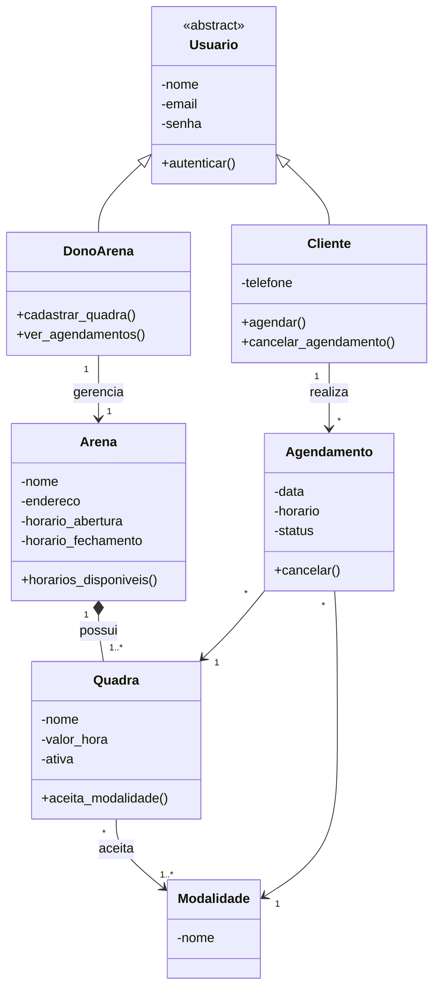
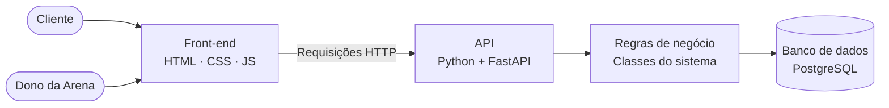
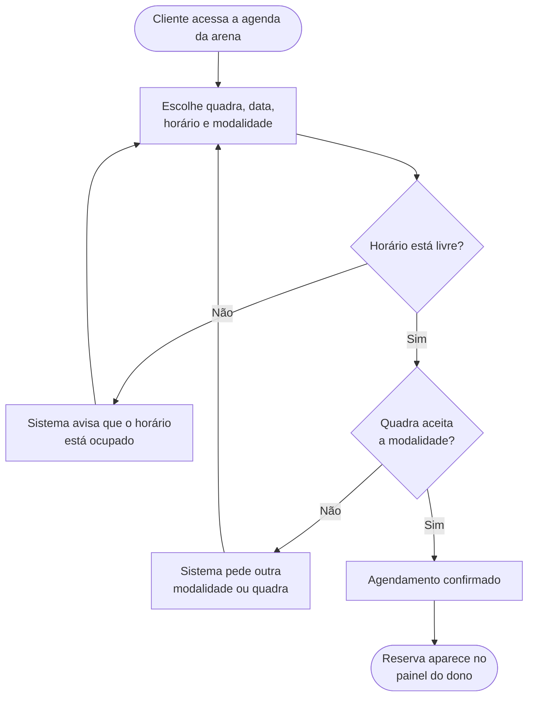

# Arena Fácil

Sistema web de agendamento de horários para arenas de quadras esportivas, desenvolvido para a disciplina de **Programação Orientada a Objetos (POO)**.

---

## O problema

Muitas arenas esportivas ainda organizam suas reservas por WhatsApp, ligação ou caderno. Isso causa alguns problemas:

- **Reservas duplicadas:** dois clientes marcam a mesma quadra no mesmo horário.
- **Atendimento manual:** o dono passa o dia respondendo "tem horário às 19h?".
- **Falta de visibilidade:** o cliente não sabe quais horários estão livres sem perguntar.
- **Falta de controle:** o dono não sabe com clareza quais horários mais vendem nem como está a ocupação da arena.

---

## A solução

O Arena Fácil é uma plataforma em que cada arena tem sua **agenda online**.

- O **cliente** acessa a agenda de uma arena, vê os horários disponíveis e faz a reserva sozinho, escolhendo quadra, data, horário e modalidade.
- O **dono da arena** tem um painel para gerenciar quadras e horários, acompanhar os agendamentos e ver informações básicas do negócio.

O próprio sistema impede que duas reservas sejam feitas na mesma quadra e no mesmo horário.

---

## Público-alvo

| Perfil | Necessidade |
|---|---|
| **Jogadores** | Reservar um horário de forma rápida, sem depender de atendimento |
| **Donos de arenas** de pequeno e médio porte | Organizar a agenda, reduzir o trabalho manual e acompanhar o movimento do negócio |

---

## Funcionalidades

### Cliente
- Cadastro e login
- Visualizar a agenda de uma arena
- Filtrar horários por data, quadra e modalidade
- Fazer agendamento
- Ver e cancelar seus agendamentos

### Dono da arena
- Cadastro e login
- Cadastrar e editar quadras
- Definir as modalidades de cada quadra
- Definir horário de funcionamento e valor por hora
- Visualizar os agendamentos do dia e da semana
- Cancelar agendamentos
- Ver informações do negócio: quantidade de reservas, horários mais procurados e faturamento estimado

### Fora do escopo desta versão
- Pagamento online
- Notificações por WhatsApp ou e-mail
- Aplicativo mobile

---

## POO — Estrutura do projeto

O sistema é construído a partir de classes que representam os elementos reais de uma arena.

### Classes

| Classe | Descrição |
|---|---|
| `Usuario` | Classe abstrata com os dados comuns a todos os usuários: nome, e-mail e senha |
| `Cliente` | Herda de `Usuario`. Faz e cancela agendamentos |
| `DonoArena` | Herda de `Usuario`. Gerencia a arena, as quadras e os agendamentos |
| `Arena` | O estabelecimento: nome, endereço, horário de funcionamento e suas quadras |
| `Quadra` | Pertence a uma arena. Tem modalidades aceitas e valor por hora |
| `Modalidade` | O esporte praticado (vôlei, futevôlei, beach tennis etc.) |
| `Agendamento` | Liga um cliente a uma quadra, modalidade, data e horário |

### Diagrama de classes

### Pilares de POO aplicados

| Pilar | Como é aplicado |
|---|---|
| **Abstração** | `Usuario` define o que todo usuário tem em comum, sem ser instanciada diretamente |
| **Encapsulamento** | Atributos privados, como a senha e o status do agendamento, que só são alterados por métodos da própria classe |
| **Herança** | `Cliente` e `DonoArena` herdam de `Usuario` |
| **Polimorfismo** | Cada tipo de usuário tem comportamentos e permissões diferentes no sistema |
| **Composição** | Uma `Arena` é formada por suas `Quadra`s |

---

## Arquitetura

### Visão geral

O sistema é dividido em camadas, cada uma com uma responsabilidade.

| Camada | Responsabilidade |
|---|---|
| **Front-end** | Telas do cliente (agenda e reservas) e painel do dono |
| **API** | Recebe as requisições do front-end e devolve as respostas |
| **Regras de negócio** | Onde ficam as classes e as validações do sistema |
| **Banco de dados** | Armazena usuários, arenas, quadras e agendamentos |

### Fluxo de agendamento

---

## Stack tecnológica

| Área | Tecnologia | Por quê |
|---|---|---|
| Back-end | **Python + FastAPI** | Python é a linguagem da disciplina; FastAPI é leve e simples |
| Banco de dados | **PostgreSQL** | Banco relacional gratuito e bem documentado |
| Front-end | **HTML, CSS e JavaScript** | Simples, sem necessidade de framework |
| Testes | **Pytest** | Padrão para testes em Python |
| DevOps | **Docker + GitHub Actions** | Mesmo ambiente para todos e testes automáticos no GitHub |
| Versionamento | **Git + GitHub** | Repositório do projeto e entregas |

---

## Membros e funções

| Membro | Função | Responsabilidades |
|---|---|---|
| **Gabriel Ferreira** | Tech Lead | Organiza as tarefas, define a arquitetura e as classes, revisa o código e integra as partes do projeto |
| **Lukas Smith** | Back-end | Desenvolve as classes, as regras de negócio e a API |
| **Lucas Viana** | Front-end | Desenvolve as telas do cliente e o painel do dono, e integra com a API |
| **Gustavo Carvalho** | Banco de Dados | Modela e cria o banco de dados |
| **Pedro Igor** | DevOps | Configura o Docker e a automação de testes no GitHub |
| **Pacífico** | Q.A. | Cria e executa os testes e garante que as regras do sistema funcionam |
