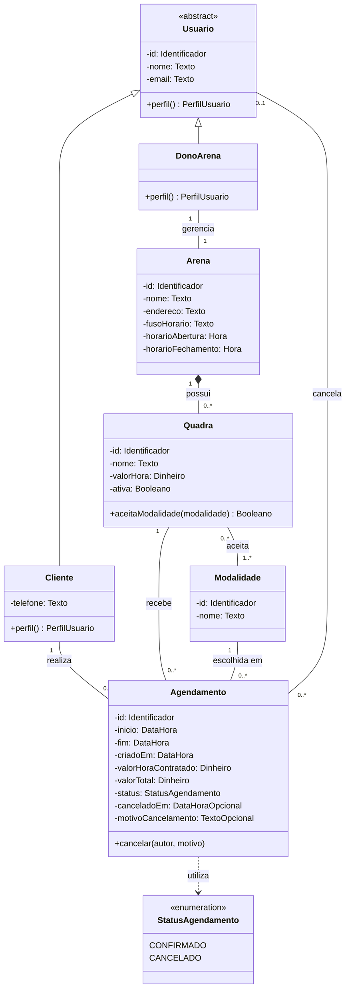

# Arena Fácil

Sistema web de agendamento de quadras esportivas, proposto para a disciplina de Programação Orientada a Objetos (POO) da UNDB.

## Situação do projeto

Esta entrega apresenta a proposta e o modelo conceitual do domínio. As funcionalidades e tecnologias abaixo são planejadas; este documento não pressupõe que já estejam implementadas. As regras detalhadas estão em [Modelo de domínio](docs/modelo-dominio.md).

## Problema e solução

Reservas organizadas por mensagens, ligações ou cadernos dificultam a consulta de horários e favorecem conflitos de agenda. O Arena Fácil oferece uma agenda por arena: o cliente escolhe quadra, data, horário e modalidade; o dono organiza as quadras e acompanha as reservas e a ocupação.

O público-alvo são jogadores e donos de arenas de pequeno e médio porte.

## Escopo da primeira versão

| Perfil | Funcionalidades previstas |
| --- | --- |
| Cliente | Cadastro e login; consultar agenda; filtrar por data, quadra e modalidade; reservar; consultar e cancelar as próprias reservas. |
| Dono da arena | Cadastro e login; gerenciar sua arena; cadastrar e editar quadras, modalidades, funcionamento e preço; consultar reservas do dia e da semana; cancelar reservas; acompanhar quantidade de reservas, horários mais procurados e faturamento estimado. |

Ficam fora do escopo: pagamento online, notificações por WhatsApp ou e-mail e aplicativo mobile. Também não são previstos nesta versão reservas recorrentes, lista de espera, promoções, multas, avaliações e bloqueios especiais de agenda.

## Decisões de negócio

Estas são as decisões adotadas para esta versão conceitual, sujeitas à evolução do projeto:

- Cada dono gerencia exatamente uma arena, que possui um único dono. Uma arena pode ser cadastrada antes de possuir quadras.
- Cada conta tem um único perfil: cliente ou dono. O e-mail é único entre todos os usuários.
- A arena funciona diariamente em uma única faixa de horário, sem atravessar a meia-noite. Datas e horários seguem o fuso da arena.
- Cada reserva ocupa exatamente uma hora, começa em hora cheia, deve estar inteiramente dentro do funcionamento e ter início futuro.
- A quadra deve estar ativa e aceitar a modalidade escolhida. Reservas confirmadas não podem se sobrepor na mesma quadra, nem para o mesmo cliente, inclusive entre arenas.
- A confirmação é imediata, sem pagamento ou aprovação manual. A disponibilidade deve ser revalidada na confirmação, inclusive em solicitações simultâneas.
- O cliente pode cancelar até duas horas antes do início, inclusive no limite. O dono pode cancelar qualquer reserva futura de sua arena, informando o motivo. Não há alteração ou reativação: cancela-se e faz-se outra reserva.
- O preço vigente é registrado na reserva e não muda depois. Reservas canceladas não compõem ocupação nem faturamento estimado, que não representa dinheiro recebido.
- Alterações de funcionamento, modalidade ou ativação de quadra não podem invalidar reservas futuras confirmadas; elas precisam ser preservadas ou canceladas antes pelo dono. O histórico é mantido.

Consulte as condições completas, exemplos e definições dos indicadores na [documentação do domínio](docs/modelo-dominio.md).

## Modelo conceitual de classes

O diagrama descreve conceitos e responsabilidades de POO, sem implementação Python ou esquema de banco de dados. Os tipos são conceituais, `-` indica atributos encapsulados e `+` indica operações públicas propostas.

`StatusAgendamento` é um tipo enumerado, não uma entidade. A associação “cancela” registra o autor do cancelamento: nenhum enquanto confirmado e exatamente um após o cancelamento. As restrições complementares estão na documentação.

## POO no domínio

| Conceito | Aplicação proposta |
| --- | --- |
| Abstração | `Usuario` reúne identidade, nome e e-mail e não é instanciado diretamente. |
| Encapsulamento | Mudanças de estado devem respeitar regras, especialmente o cancelamento de `Agendamento`. |
| Herança | `Cliente` e `DonoArena` especializam `Usuario`. |
| Polimorfismo | A operação comum `perfil()` retorna CLIENTE ou DONO_ARENA conforme a especialização. Diferenças de permissão, isoladamente, não demonstram polimorfismo. |
| Composição | `Quadra` pertence exclusivamente a uma `Arena` e não existe fora dela; isso não exige apagar o histórico. |

Login integra o escopo funcional, mas armazenamento de credenciais e mecanismos de autenticação serão definidos no projeto técnico. Senha em texto puro não é atributo deste modelo de domínio.

## Arquitetura e tecnologias planejadas

A organização prevista separa interface web, API, regras de domínio e persistência. A interface consulta a API, que coordena as regras e o acesso aos dados. A agenda e os indicadores são consultas derivadas, sem exigir entidades próprias.

| Área | Tecnologia prevista |
| --- | --- |
| Interface | HTML, CSS e JavaScript |
| API | Python e FastAPI |
| Persistência | PostgreSQL |
| Testes | Pytest |
| Ambiente e integração contínua | Docker e GitHub Actions |
| Versionamento | Git e GitHub |

A implementação deverá garantir a indivisibilidade da verificação de disponibilidade e da confirmação da reserva. O mecanismo será escolhido na etapa técnica.

## Documentação

- [Modelo de domínio e regras de negócio](docs/modelo-dominio.md)

## Membros e funções

| Membro | Função | Responsabilidade |
| --- | --- | --- |
| Gabriel Ferreira | Tech Lead | Organização, arquitetura, revisão e integração. |
| Lukas Smith | Back-end | Classes, regras de negócio e API. |
| Lucas Viana | Front-end | Telas e integração com a API. |
| Gustavo Carvalho | Banco de Dados | Modelagem e criação do banco. |
| Pedro Igor | DevOps | Ambiente e automação de testes. |
| Pacífico | Q.A. | Planejamento e execução de testes. |
