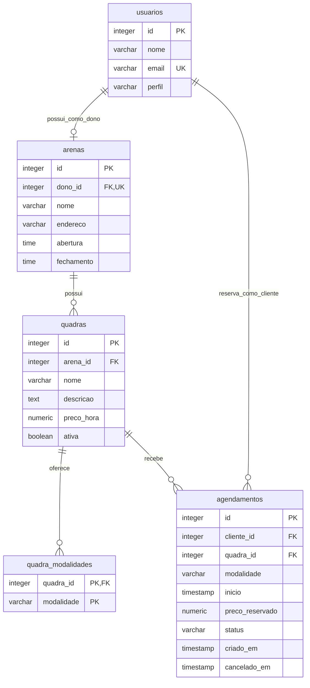

# Modelo do banco de dados

[Voltar ao README](../README.md) · [Modelo de domínio](modelo-dominio.md) · [Requisitos](engenharia-requisitos.md)

O Arena Fácil utiliza PostgreSQL para guardar usuários, arenas, quadras e reservas. O banco possui cinco tabelas, definidas em [sql/schema.sql](../sql/schema.sql).

## Tabelas

| Tabela               | O que armazena                                                                                    |
| -------------------- | ------------------------------------------------------------------------------------------------- |
| `usuarios`           | Nome, e-mail e perfil de clientes e donos. O e-mail é único e não há senha.                       |
| `arenas`             | Nome, endereço, dono e horários de abertura e fechamento. Cada dono pode ter uma arena.           |
| `quadras`            | Arena à qual pertence, nome, descrição, preço por hora e situação ativa/inativa.                  |
| `quadra_modalidades` | Modalidades permitidas em cada quadra: futevôlei, vôlei e beach tênis.                            |
| `agendamentos`       | Cliente, quadra, modalidade, horário, preço contratado, estado e datas de criação e cancelamento. |

`quadra_modalidades` é uma tabela auxiliar. Sua chave é formada por `quadra_id` e `modalidade`, impedindo repetir a mesma modalidade na mesma quadra.

## Diagrama relacional

- **PK:** chave primária, que identifica um registro. Nas tabelas principais, o id é gerado automaticamente.
- **FK:** chave estrangeira, que liga um registro a outra tabela.
- **UK:** campo que não pode ter valores repetidos.

Cada arena pertence a um dono e pode ter várias quadras. Cada reserva está ligada a um cliente e a uma quadra. O diagrama mostra as relações permitidas pelo SQL; a aplicação também verifica o perfil do usuário e cadastra dono e arena juntos.

## Regras principais

- Os preços são positivos, com duas casas decimais. A reserva guarda o preço contratado, mesmo que o valor da quadra mude depois.
- Cada reserva dura uma hora e começa em hora cheia. O término é calculado a partir do início, sem um campo adicional no banco.
- Dois índices únicos impedem reservas `CONFIRMADO` no mesmo horário para a mesma quadra ou cliente. Reservas `CANCELADO` deixam o horário livre.
- O cancelamento mantém o registro e preenche `cancelado_em`. Reservas confirmadas deixam esse campo vazio.
- Quadras com reserva futura confirmada não podem ser retiradas. Sem histórico, podem ser apagadas; com histórico, são desativadas. Ao apagar uma quadra sem histórico, suas modalidades também são removidas.
- Datas e horários seguem `America/Fortaleza`, armazenados como horário local em `TIMESTAMP` sem offset.

O banco protege os vínculos, os valores permitidos e os conflitos de horário. A aplicação complementa essas regras, verificando perfil, propriedade, modalidade da quadra, funcionamento, ativação e prazo de cancelamento. Nem todas essas condições são verificadas pelo SQL sozinho.

## Acesso ao banco

A conexão usa Psycopg e a variável `DATABASE_URL`, configurada no ambiente ou no `.env` local. O arquivo [database.py](../backend/database.py) abre as conexões, enquanto [services.py](../backend/services.py) coordena as regras e as transações.

As consultas utilizam parâmetros separados do comando SQL. As alterações são confirmadas quando a operação termina com sucesso ou desfeitas em caso de erro. Durante reservas, edição e exclusão de quadras, o sistema utiliza bloqueios de registros para coordenar operações simultâneas.

Na inicialização da API, as tabelas são criadas a partir de `schema.sql`, caso ainda não existam. O banco e o usuário precisam estar criados previamente; essa inicialização não atualiza automaticamente um esquema antigo.

As instruções para executar o sistema e testar a persistência estão no [README](../README.md#executar-os-testes).
