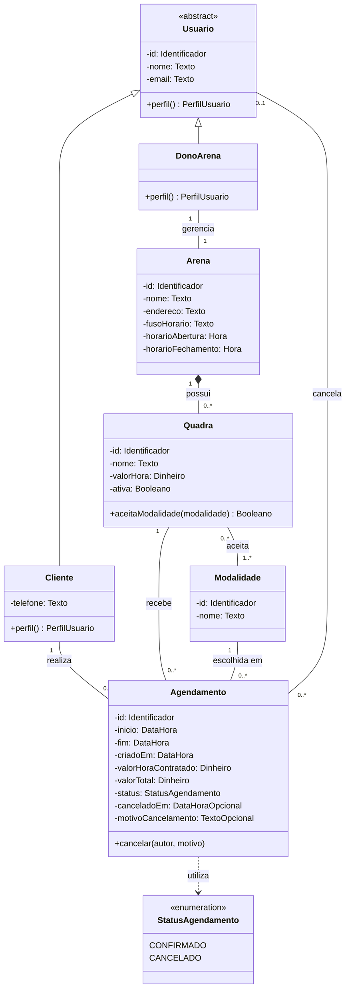

# Modelo de domínio — Arena Fácil

[Voltar ao README](../README.md)

## Objetivo e limites

O Arena Fácil permite consultar a agenda de arenas esportivas e reservar quadras, reduzindo conflitos e trabalho manual. Este documento especifica o modelo conceitual de POO da primeira versão, sem implementação Python, desenho de API ou esquema de banco de dados.

As regras abaixo são decisões adotadas nesta modelagem para tornar a proposta original consistente. Não representam regras previamente aprovadas pela equipe. Pagamentos online, notificações e aplicativo mobile permanecem fora do escopo; reservas recorrentes, lista de espera, promoções, multas, avaliações e bloqueios especiais também não fazem parte desta versão.

## Vocabulário e responsabilidades

| Conceito | Significado e responsabilidade |
| --- | --- |
| Usuario | Identidade abstrata com nome e e-mail; fornece o contrato comum `perfil()`. |
| Cliente | Usuário que consulta a agenda e solicita ou cancela suas reservas. Possui telefone de contato. |
| DonoArena | Usuário responsável por uma arena e autorizado a gerenciar seus recursos e reservas. |
| Arena | Estabelecimento com endereço, fuso e faixa diária de funcionamento. |
| Quadra | Recurso físico de uma arena, com nome, preço por hora, situação ativa e modalidades aceitas. |
| Modalidade | Esporte disponível em um catálogo compartilhado, como vôlei, futevôlei ou beach tennis. |
| Agendamento | Reserva de uma quadra por um cliente, para uma modalidade e um intervalo, com preço e estado registrados. |
| Agenda | Visão calculada a partir de funcionamento, quadras e reservas; não é entidade independente. |

## Diagrama UML

Tipos e operações são conceituais. `-` indica encapsulamento; `+`, operação pública. `Identificador` representa uma identidade estável, `Dinheiro` um valor monetário em reais com duas casas decimais e `DataHora` um instante interpretado no fuso da arena. Sufixo `Opcional` permite ausência de valor.

## Atributos e associações

Todos os identificadores são únicos e estáveis no respectivo tipo. Nome, e-mail, telefone, endereço e fuso são obrigatórios nas classes em que aparecem. O telefone é um contato, não uma identidade. O e-mail é único entre todos os usuários, desconsiderando maiúsculas e espaços nas extremidades. O fuso identifica a referência temporal do estabelecimento.

`inicio` e `fim` substituem uma data e um horário isolados, permitindo representar o intervalo completo. `criadoEm` registra a criação. Os valores contratados preservam o preço histórico. `canceladoEm`, `motivoCancelamento` e a associação com o autor registram o cancelamento. Não se duplicam cliente, quadra e modalidade como atributos: eles já são expressos pelas associações.

| Relacionamento | Cardinalidade e restrição |
| --- | --- |
| DonoArena–Arena | Cada dono gerencia exatamente uma arena; cada arena possui exatamente um dono. O cadastro de ambos é concluído em conjunto. |
| Arena–Quadra | Uma arena possui zero ou muitas quadras; cada quadra pertence exclusivamente a uma arena e não é transferida. Sem quadras ativas, a arena não oferece horários. |
| Quadra–Modalidade | Cada quadra aceita uma ou mais modalidades; uma modalidade pode estar associada a zero ou muitas quadras. |
| Cliente–Agendamento | Cada agendamento possui exatamente um cliente; um cliente pode ter zero ou muitos agendamentos. |
| Quadra–Agendamento | Cada agendamento reserva exatamente uma quadra; uma quadra acumula zero ou muitos agendamentos ao longo do tempo. |
| Modalidade–Agendamento | Cada agendamento escolhe exatamente uma modalidade; uma modalidade pode aparecer em zero ou muitos agendamentos. |
| Usuario–Agendamento (cancela) | Cada agendamento tem zero ou um autor de cancelamento; um usuário pode cancelar zero ou muitos agendamentos, respeitando suas permissões. |

A generalização de `Usuario` é completa e exclusiva: cada usuário é cliente ou dono, nunca ambos na mesma conta. `perfil()` retorna CLIENTE ou DONO_ARENA. A autenticação é requisito funcional, mas credenciais e seus mecanismos de proteção pertencem ao projeto técnico.

## Regras de negócio

- **Acesso:** o cliente gerencia suas próprias reservas; o dono gerencia apenas sua arena.
- **Horários:** a arena possui uma faixa diária de funcionamento, sem atravessar a meia-noite. Reservas duram uma hora, começam em hora cheia e devem ocorrer no futuro, dentro dessa faixa.
- **Disponibilidade:** a quadra deve estar ativa e aceitar a modalidade. Não pode haver sobreposição de reservas confirmadas para a mesma quadra ou cliente. Horários consecutivos são permitidos, e a disponibilidade é verificada na confirmação.
- **Cancelamento:** o cliente pode cancelar até duas horas antes do início; o dono pode cancelar reservas futuras de sua arena com motivo. O cancelamento registra autor e data e libera o horário. Para mudar uma reserva, é necessário cancelar e reservar novamente.
- **Preço:** o valor por hora deve ser positivo e fica registrado na confirmação. Alterações de preço não afetam reservas existentes.
- **Histórico:** alterações na arena ou nas quadras devem preservar reservas futuras confirmadas. Registros vinculados a agendamentos são mantidos, assim como o fuso usado nas reservas.

### Estados do agendamento

- **CONFIRMADO:** reserva aceita e sem cancelamento.
- **CANCELADO:** reserva cancelada, com autor e data registrados. O motivo é obrigatório quando o dono cancela.

Reservas passadas permanecem CONFIRMADAS se não tiverem sido canceladas. Esse estado não comprova comparecimento ou pagamento.

## Fluxos principais

**Reservar:** o cliente consulta a agenda, escolhe uma quadra, modalidade e horário. O sistema valida perfil, funcionamento, antecedência, ativação, modalidade e conflitos; registra preço e confirma. Se uma validação falhar, não cria o agendamento e informa a razão.

**Cancelar:** o cliente ou dono solicita o cancelamento. O sistema valida vínculo, estado, prazo e motivo quando exigido; registra o autor e o instante e libera o horário. Uma solicitação fora das condições mantém a reserva original.

**Gerenciar a arena:** o dono cadastra quadras, escolhe modalidades e define preço e funcionamento. Alterações devem preservar o histórico e as reservas futuras confirmadas.

## Indicadores do negócio

Os indicadores são consultas derivadas, não entidades. Consideram reservas cujo início pertence ao período consultado, no fuso da arena, e excluem CANCELADAS:

- **Quantidade de reservas:** número de agendamentos CONFIRMADOS no período.
- **Ocupação reservada:** soma das horas desses agendamentos por quadra, dia ou semana. Esta versão informa horas reservadas, sem taxa percentual.
- **Horários mais procurados:** quantidade de reservas por hora de início local; empates são apresentados juntos. O indicador mede reservas registradas, sem contabilizar buscas ou tentativas recusadas.
- **Faturamento estimado:** soma de valorTotal desses agendamentos, incluindo os futuros no período. Não representa recebimento, pois não há controle de pagamentos.

